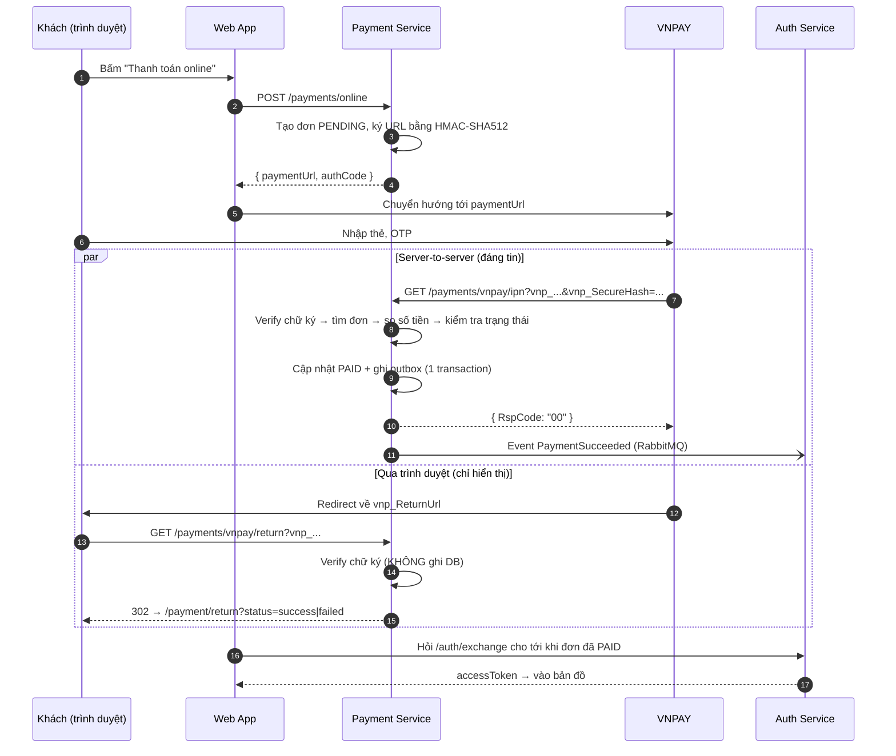

# Tích hợp VNPAY (Sandbox) — Payment Service

Tài liệu này mô tả cách hệ thống tích hợp cổng thanh toán VNPAY (API 2.1.0), cách cấu hình môi trường Sandbox, cách chạy thử và các câu hỏi thường gặp khi vấn đáp.

---

## 1. Luồng thanh toán tổng quát



Nguyên tắc cốt lõi:

| Endpoint | Ai gọi | Được ghi DB? | Mục đích |
|---|---|---|---|
| `POST /payments/online` | Frontend | Có (tạo đơn) | Tạo đơn + URL thanh toán có chữ ký |
| `GET /payments/vnpay/return` | Trình duyệt khách | **Không** | Hiển thị thành công/thất bại |
| `GET /payments/vnpay/ipn` | Server VNPAY | **Có** | Nguồn sự thật duy nhất về kết quả thanh toán |

Màn hình "thành công" của frontend không dựa vào Return URL. Frontend hỏi Auth Service cho tới khi IPN đã cập nhật đơn sang `PAID`, nên nếu ai đó sửa Return URL thành `status=success` thì vẫn không nhận được vé.

---

## 2. Các file liên quan

| File | Nội dung |
|---|---|
| `services/payment-service/src/services/vnpay.ts` | **Lõi**: sắp xếp tham số, ký HMAC-SHA512, tạo URL, verify chữ ký, định dạng ngày GMT+7. Không đụng DB. |
| `services/payment-service/src/services/vnpay-ipn.ts` | Xử lý IPN: verify → tìm đơn → so tiền → kiểm tra trạng thái → cập nhật DB + outbox |
| `services/payment-service/src/services/vnpay-return.ts` | Xử lý Return URL: verify chữ ký, chọn trang kết quả, **chỉ đọc** DB |
| `services/payment-service/src/routes/vnpay.ts` | Khai báo 2 endpoint `/payments/vnpay/return` và `/payments/vnpay/ipn` |
| `services/payment-service/src/services/orders.ts` | `startOnlineOrder` gọi `buildPaymentUrl` khi `ONLINE_PAYMENT_PROVIDER=vnpay` |
| `services/payment-service/src/config.ts` | Đọc biến môi trường VNPAY, `assertConfig()` dừng service nếu thiếu |
| `services/api-gateway/src/index.ts` | Cho 2 endpoint VNPAY đi qua không cần JWT |
| `services/payment-service/scripts/vnpay-selftest.ts` | 10 unit test cho phần chữ ký |
| `services/payment-service/scripts/vnpay-sim-ipn.ts` | Giả lập VNPAY gọi IPN (test local, demo tấn công) |

Không cần migration mới: dùng lại bảng `payment_orders`, `payment_transactions` (provider = `VNPAY`) và `webhook_events` (nhật ký IPN).

---

## 3. Cấu hình môi trường

### 3.1. Đăng ký tài khoản Sandbox

1. Đăng ký tại <https://sandbox.vnpayment.vn/devreg/>.
2. VNPAY gửi email gồm:
   - **vnp_TmnCode** (mã website, 8 ký tự)
   - **vnp_HashSecret** (chuỗi bí mật để ký)
   - Tài khoản đăng nhập trang quản trị merchant sandbox
   - URL thanh toán sandbox: `https://sandbox.vnpayment.vn/paymentv2/vpcpay.html`

### 3.2. Điền file `.env` (thư mục gốc dự án)

```env
ONLINE_PAYMENT_PROVIDER=vnpay
VNP_TMN_CODE=XXXXXXXX                 # vnp_TmnCode trong email
VNP_HASH_SECRET=XXXXXXXXXXXXXXXXXXXX  # vnp_HashSecret trong email
VNP_URL=https://sandbox.vnpayment.vn/paymentv2/vpcpay.html
VNP_RETURN_URL=                       # để trống = ${PUBLIC_BASE_URL}/api/payments/vnpay/return

FRONTEND_URL=https://xxxx.ngrok-free.app
PUBLIC_BASE_URL=https://xxxx.ngrok-free.app
```

| Biến | Ý nghĩa | Bắt buộc |
|---|---|---|
| `ONLINE_PAYMENT_PROVIDER` | `vnpay` để nút "Thanh toán online" dùng VNPAY (`payoo` = mock cũ) | Có |
| `VNP_TMN_CODE` | Mã website VNPAY cấp. Server kiểm tra IPN có đúng mã này | Có |
| `VNP_HASH_SECRET` | Khóa bí mật ký/verify. **Chỉ để ở server**, không commit (`.env` đã có trong `.gitignore`) | Có |
| `VNP_URL` | URL cổng thanh toán. Khi lên production đổi thành URL production | Có (có mặc định) |
| `VNP_RETURN_URL` | Nơi VNPAY đưa trình duyệt khách về | Không (tự suy ra từ `PUBLIC_BASE_URL`) |

Thiếu `VNP_TMN_CODE` hoặc `VNP_HASH_SECRET` khi đã bật `vnpay` thì payment-service **dừng ngay lúc khởi động** và báo rõ biến nào thiếu.

Sau khi sửa `.env`: `docker compose up -d --build payment-service api-gateway`.

### 3.3. Khai báo IPN URL trên trang merchant

IPN URL **không** gửi trong URL thanh toán mà khai báo trên trang quản trị của VNPAY:

1. Đăng nhập <https://sandbox.vnpayment.vn/merchantv2/>.
2. Vào **Thông tin tài khoản**, sửa website (hoặc mở thẳng trang `.../merchantv2/Account/TerminalEdit.htm`).
3. Điền IPN URL: `https://xxxx.ngrok-free.app/api/payments/vnpay/ipn`

### 3.4. Vì sao cần ngrok?

Server VNPAY nằm trên Internet nên **không gọi được `localhost`** của bạn. Dùng ngrok để có URL công khai:

```bash
ngrok http 5175      # cổng web (nginx) đã proxy /api -> gateway -> payment-service
```

Mỗi lần ngrok đổi link, cập nhật lại `FRONTEND_URL`, `PUBLIC_BASE_URL` trong `.env` **và** IPN URL trên trang merchant. Bản ngrok miễn phí hiện một trang cảnh báo khi trình duyệt quay về Return URL: bấm "Visit Site" là được (IPN gọi từ server nên không bị ảnh hưởng).

---

## 4. Chạy thử trên Sandbox

1. Mở web app qua link ngrok, bấm **Thanh toán online**.
2. Trên trang VNPAY chọn **Thẻ nội địa → NCB** và nhập thẻ test (danh sách đầy đủ ở trang tài liệu sandbox của VNPAY):

   | Trường | Giá trị |
   |---|---|
   | Số thẻ | `9704198526191432198` |
   | Tên chủ thẻ | `NGUYEN VAN A` |
   | Ngày phát hành | `07/15` |
   | OTP | `123456` |

3. Kiểm tra kết quả:

```bash
docker compose logs -f payment-service
docker compose exec postgres psql -U postgres -d payment_db -c \
  "select order_code, status, paid_at from payment_orders order by created_at desc limit 5;"
docker compose exec postgres psql -U postgres -d payment_db -c \
  "select event_id, signature_valid, note from webhook_events where provider='VNPAY' order by received_at desc;"
```

Thử thất bại: trên trang VNPAY bấm **Hủy giao dịch** → mã `24`, đơn chuyển `FAILED`.

---

## 5. Test không cần ngrok (và demo bảo mật khi vấn đáp)

Trong `services/payment-service` (cần `npm install`, có `VNP_TMN_CODE`, `VNP_HASH_SECRET` trong môi trường hoặc `.env`):

```bash
# Unit test phần chữ ký (không cần DB)
npx tsx scripts/vnpay-selftest.ts

# Tạo đơn rồi giả lập VNPAY gọi IPN cho đơn đó
npx tsx scripts/vnpay-sim-ipn.ts <orderCode> 20000 bad-signature   # -> 97 (giả mạo bị chặn)
npx tsx scripts/vnpay-sim-ipn.ts <orderCode> 20000 wrong-amount    # -> 04 (lệch số tiền)
npx tsx scripts/vnpay-sim-ipn.ts <orderCode> 20000 unknown-order   # -> 01
npx tsx scripts/vnpay-sim-ipn.ts <orderCode> 20000 success         # -> 00, đơn PAID
npx tsx scripts/vnpay-sim-ipn.ts <orderCode> 20000 success         # -> 02 (gọi lại, không xử lý lặp)
```

Mặc định script gọi thẳng `http://localhost:4002`. Đi qua gateway thì thêm tham số cuối `http://localhost:8080/api`.

Xem Return URL dạng JSON (Postman): gọi `GET /payments/vnpay/return?...` với header `Accept: application/json`.

---

## 6. Bảng mã

### 6.1. Mã server trả về cho VNPAY trong IPN (`RspCode`)

| RspCode | Message | Khi nào |
|---|---|---|
| `00` | Confirm Success | Cập nhật đơn thành công (kể cả khi kết quả là thanh toán thất bại) |
| `01` | Order not found | Không có đơn VNPAY với `vnp_TxnRef` này |
| `02` | Order already confirmed | Đơn không còn `PENDING` (đã xử lý trước đó) |
| `04` | Invalid amount | `vnp_Amount` khác `amount × 100` trong DB |
| `97` | Invalid signature | Sai chữ ký hoặc sai `vnp_TmnCode` |
| `99` | Unknown error | Lỗi bất ngờ (DB sập...) — VNPAY sẽ gọi lại |

### 6.2. Kết quả giao dịch VNPAY gửi về (`vnp_ResponseCode`)

Thành công **chỉ khi** `vnp_ResponseCode = 00` **và** `vnp_TransactionStatus = 00`. Các mã khác (24: khách hủy, 51: không đủ số dư, 11: hết hạn chờ, ...) có mô tả trong `VNP_RESPONSE_MESSAGES` ở `vnpay.ts`.

---

## 7. Câu hỏi vấn đáp thường gặp

**1. Chữ ký điện tử được tạo thế nào?**
Lấy các tham số `vnp_*` (trừ `vnp_SecureHash`), sắp xếp tên theo a→z, encode giá trị (dấu cách thành `+`), nối thành `key=value&key=value`, rồi tính `HMAC-SHA512(HashSecret, chuỗi đó)` ra hex (hàm `buildSignData` + `sign` trong `vnpay.ts`). Sắp xếp để hai bên luôn tạo ra cùng một chuỗi, bất kể thứ tự tham số.

**2. Vì sao là HMAC-SHA512 mà không phải SHA512 thường?**
SHA512 thường ai cũng tính được, nên kẻ gian sửa dữ liệu rồi tự tính lại hash là xong. HMAC trộn thêm `HashSecret` mà chỉ VNPAY và server mình biết, nên không có secret thì không tạo được chữ ký hợp lệ.

**3. Vì sao không cập nhật DB ở Return URL?**
Return URL đi qua trình duyệt khách. Khách có thể tắt tab hoặc mất mạng (đơn không bao giờ được cập nhật), và có thể sửa URL. IPN do server VNPAY gọi trực tiếp, có chữ ký, và VNPAY sẽ gọi lại nếu chưa nhận được phản hồi xác nhận, nên đây là nơi duy nhất ghi DB.

**4. Kẻ gian tự gọi `/ipn?vnp_ResponseCode=00...` thì sao?**
Không có `HashSecret` nên chữ ký sai → trả `97`, ghi `webhook_events` với `signature_valid=false`, đơn không đổi. Demo bằng `vnpay-sim-ipn.ts ... bad-signature`.

**5. Sửa số tiền trên URL thanh toán (20.000đ thành 1.000đ) được không?**
Không. `vnp_Amount` nằm trong chuỗi đã ký nên VNPAY phát hiện sai chữ ký và từ chối. Thêm một lớp nữa: IPN luôn so `vnp_Amount` với số tiền lưu trong DB (snapshot lúc tạo đơn), lệch thì trả `04` và không cập nhật.

**6. VNPAY gọi IPN nhiều lần, hoặc 2 lần cùng lúc thì sao?**
- Gọi lại tuần tự: đơn đã `PAID` → trả `02`, không làm gì thêm.
- Gọi đồng thời: `SELECT ... FOR UPDATE` khóa dòng đơn hàng, lần thứ hai phải chờ lần thứ nhất commit, sau đó thấy `PAID` → `02`. Đã test 5 IPN gọi cùng lúc: đúng 1 lần `00`, 4 lần `02`, chỉ 1 event `PaymentSucceeded`.

**7. Vì sao cập nhật đơn và ghi event trong cùng một transaction (Outbox)?**
Nếu cập nhật `PAID` xong rồi gửi RabbitMQ bị lỗi, khách đã trả tiền mà không nhận được vé. Ghi event vào bảng `outbox_events` cùng transaction thì hoặc cả hai cùng thành công, hoặc cả hai cùng rollback. Một tiến trình nền đẩy outbox lên RabbitMQ sau.

**8. Vì sao `vnp_Amount` nhân 100?**
VNPAY quy định gửi số tiền dạng số nguyên đã nhân 100 (bỏ phần thập phân): 20.000đ → `2000000`. Khi verify IPN cũng phải so với `amount × 100`.

**9. Vì sao tự cộng 7 giờ khi định dạng ngày?**
`vnp_CreateDate` và `vnp_ExpireDate` phải theo giờ Việt Nam (GMT+7). Container Docker thường chạy UTC; dùng giờ server sẽ lệch 7 tiếng và VNPAY báo giao dịch quá hạn. `formatVnpDate` cộng 7 giờ rồi đọc theo UTC nên không phụ thuộc múi giờ server.

**10. Vì sao so sánh chữ ký bằng `timingSafeEqual` mà không dùng `===`?**
`===` dừng ngay ở ký tự sai đầu tiên, nên thời gian phản hồi lộ ra số ký tự đúng (timing attack). `timingSafeEqual` luôn so hết chuỗi trong thời gian như nhau.

**11. Khách thanh toán thành công nhưng đơn đã hết hạn thì sao?**
`vnp_ExpireDate` được đặt bằng thời điểm hết hạn của đơn nên VNPAY chặn thanh toán sau thời điểm đó. Nếu vẫn xảy ra, IPN trả `02` và ghi `LATE_PAYMENT_REVIEW` vào `webhook_events` cùng log lỗi để nhân viên đối soát, hoàn tiền thủ công.

**12. IPN gặp lỗi DB thì sao?**
Transaction rollback, trả `99`. VNPAY hiểu là chưa xử lý xong và sẽ gọi lại sau.

---

## 8. Lỗi thường gặp

| Hiện tượng | Nguyên nhân / cách xử lý |
|---|---|
| Trang VNPAY báo "Sai chữ ký" | Sai `VNP_HASH_SECRET` / `VNP_TMN_CODE`, hoặc có khoảng trắng thừa khi copy từ email |
| "Giao dịch đã quá thời gian chờ" | Đồng hồ máy sai, hoặc đơn đã quá 30 phút (`onlineOrderTtlMin`) |
| Thanh toán xong nhưng đơn vẫn `PENDING` | IPN chưa tới: kiểm tra IPN URL trên trang merchant, ngrok còn chạy, `docker compose logs payment-service` |
| `webhook_events` có `INVALID_SIGNATURE` | Ai đó gọi IPN không có chữ ký đúng, hoặc HashSecret trên server khác với trên trang merchant |
| Service không khởi động, báo "Thiếu cấu hình VNPAY" | Điền `VNP_TMN_CODE`, `VNP_HASH_SECRET` hoặc đặt `ONLINE_PAYMENT_PROVIDER=payoo` |
